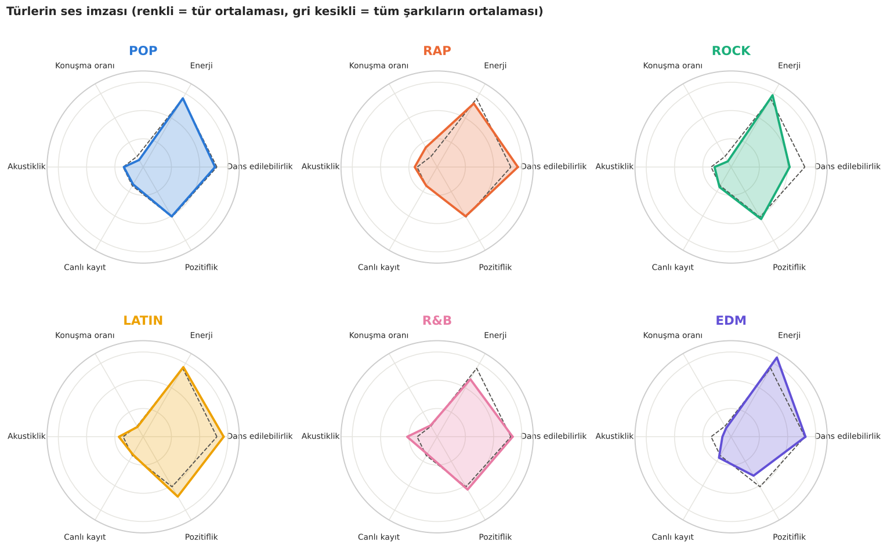
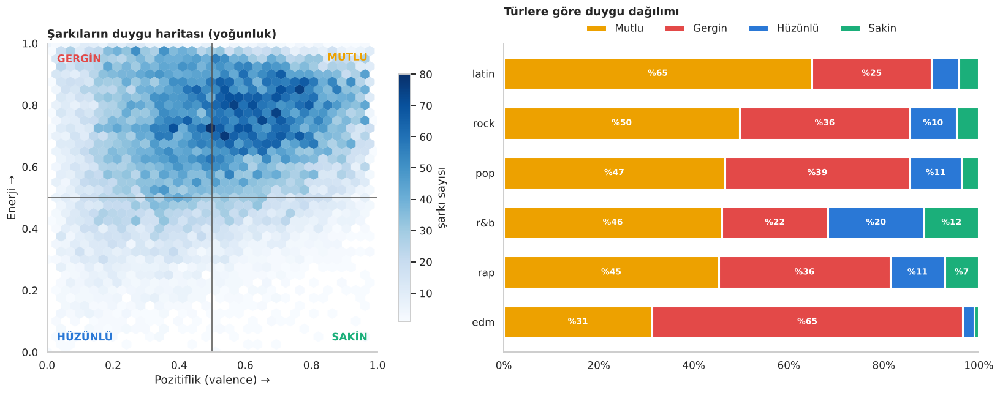
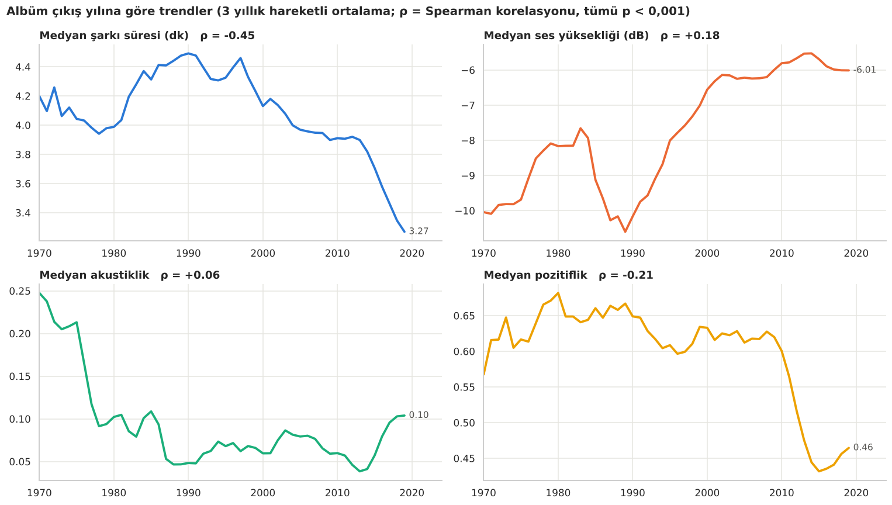
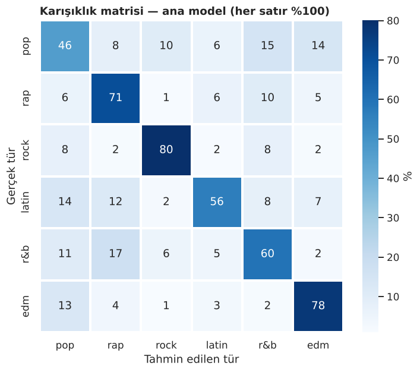
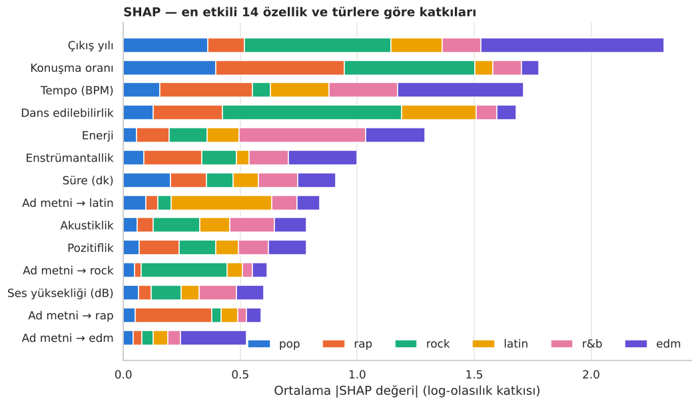

# Spotify Şarkılarında Tür ve Duygu Analizi

Bu projede yaklaşık 32 bin Spotify şarkısının ses özelliklerinden yola çıkarak tek bir soruyu takip ettim: bir şarkının sesi, onun türü, duygusu ve ne kadar dinlendiği hakkında ne söylüyor? Veriyi TidyTuesday'in [Spotify Songs (2020-01-21)](https://github.com/rfordatascience/tidytuesday/tree/master/data/2020/2020-01-21) setinden aldım. Sette 6 ana tür, 24 alt tür ve her şarkı için dans edilebilirlik, enerji, pozitiflik, tempo gibi 12 ses özelliği var.

Aynı şarkı birden fazla çalma listesinde yer aldığı için veride tekrar ediyor, hatta bazen farklı türlerde. Bu yüzden genel analizler için her şarkıyı bir kez tutan bir set, tür modeli için de yalnızca tek bir türe ait şarkılardan oluşan ikinci bir set kurdum.



## Neler yaptım

Önce türlerin gerçekten farklı olup olmadığına baktım. Dağılımlar normal olmadığı için Kruskal-Wallis testini kullandım, ama 26 bin şarkıda neredeyse her fark anlamlı çıkacağından asıl etki büyüklüğüne (ε²) odaklandım. Türleri en iyi ayıran özellikler konuşma oranı (ε² = 0,20) ve dans edilebilirlik (ε² = 0,19) oldu; canlı kayıt oranı neredeyse hiç fark yaratmıyor (ε² = 0,005).

Duygular için Russell'ın modelini (pozitiflik × enerji) kullanıp şarkıları dört bölgeye ayırdım. Latin şarkıların %65'i "mutlu" bölgede, EDM ise yüksek enerjisine rağmen %65 oranında "gergin" çıkıyor.



Zaman içindeki değişimi Spearman korelasyonuyla test ettim (tüm trendler p < 0,001). 1990'lardan 2010'lara şarkıların medyan süresi 4,4 dakikadan 3,5 dakikaya indi, ses seviyesi −9,3 dB'den −5,9 dB'ye çıktı ve pozitiflik 0,62'den 0,47'ye düştü. Hüzünlü ve gergin şarkıların payı %32'den %55'e çıkmış.



Popülerlik kısmı beni en çok şaşırtan yer oldu. Ses özellikleri popülerliğin yalnızca %7'sini açıklıyor; yıl ve tür eklenince %13, sanatçı bilgisiyle %26. Sanatçı ortalamasını doğrudan hesaplamak sızıntı yaratacağı için katlama dışı (out-of-fold) hedef kodlama kullandım; her şarkının sanatçı ortalaması o şarkının bulunmadığı katlardan geliyor. R²'nin bu kadar düşük kalması, popülerliğin büyük kısmının veride olmayan şeylerle (pazarlama, çalma listesi yerleşimi vb.) belirlendiğini düşündürüyor.

## Tür tahmini

6 türü tahmin eden bir model kurdum (rastgele tahmin %16,7). Her adımda modele tek bir bilgi grubu ekleyip katkısını ayrı ayrı ölçtüm:

| Adım | Test doğruluğu | İlk 2 doğruluk |
|---|---|---|
| Yalnızca ses özellikleri (Optuna ile ayarlı LightGBM) | %62,2 | %80,3 |
| + şarkı adı ipuçları | %64,3 | %82,5 |
| + şarkı adından TF-IDF metin modeli (stacking), final | %65,8 | %83,9 |
| + LightGBM ve RF ensemble | %65,8 | %83,7 |
| Sanatçı bilgisiyle (ayrı senaryo) | %77,9 | %89,9 |

Final modelin macro F1 değeri 0,653. Benim için en öğretici kısım, Optuna ile yaptığım hiperparametre aramasının ses özellikleriyle %62 civarındaki tavanı aşamaması oldu. Artış daha karmaşık bir modelden değil, modele farklı türde bilgi vermekten geldi. Ensemble de bu veride ek bir şey katmadı.

Modelin sanatçıları ezberleyip ezberlemediğini görmek için sanatçıya göre gruplanmış bir bölme (GroupKFold) da denedim; doğruluk yalnızca 1,5 puan düştü. SHAP grafikleri istatistiksel testlerle tutarlı: rap için en belirleyici özellik konuşma oranı, rock için düşük dans edilebilirlik. Rock (%80) ve EDM (%78) iyi ayrılıyor, pop (%46) ise diğer bütün türlerle örtüştüğü için en zoru.

 

Modelin en emin olduğu halde yanıldığı şarkılara baktığımda çoğunun aslında etiket sorunu olduğunu gördüm. Örneğin The Cure'un "Just Like Heaven"ı veride pop etiketli, model ise rock diyor.

## Öneri sistemi

Son olarak standartlaştırılmış ses özellikleri (ve isteğe bağlı olarak tür bilgisi) üzerinde kosinüs benzerliğiyle çalışan basit bir öneri sistemi yazdım. "Doğru cevap" olmadığı için dolaylı bir ölçüt kullandım: ilk 10 önerinin kaçı kaynak şarkıyla aynı alt türden? Rastgele 1.000 şarkıda yalnızca ses özellikleriyle rastgeleye göre 3 kat, tür bilgisiyle 7,7 kat daha isabetli sonuç aldım. Notebook'ta ayrıca hedef enerji ve pozitifliğe göre çalma listesi oluşturan küçük bir fonksiyon var.

## Çalıştırmak için

```bash
git clone https://github.com/Memreu/Spotify-Genre-and-Mood-Analysis.git
cd Spotify-Genre-and-Mood-Analysis
pip install -r requirements.txt
jupyter lab spotify_analizi.ipynb
```

Veri ilk çalıştırmada TidyTuesday deposundan otomatik indiriliyor, notebook'un tamamı 12 dakika kadar sürüyor. Kurmadan bakmak isterseniz [nbviewer](https://nbviewer.org/github/Memreu/Spotify-Genre-and-Mood-Analysis/blob/main/spotify_analizi.ipynb) üzerinden bütün çıktılarla okunabiliyor; Colab'da çalıştırmak için önce `!pip install -q optuna shap` yeterli.

## Sınırlılıklar

Tür etiketleri şarkının kendisinden değil, eklendiği çalma listesinden geliyor; bu etiket gürültüsü doğruluğun üst sınırını belirliyor. Ses özellikleri de Spotify'ın özet metrikleri, ham ses kullanmadım. Bundan sonra şarkı sözlerini eklemeyi ve 24 alt türü önce ana tür, sonra alt tür şeklinde hiyerarşik bir modelle tahmin etmeyi denemek istiyorum.

MIT lisansı ile paylaşılmıştır.
