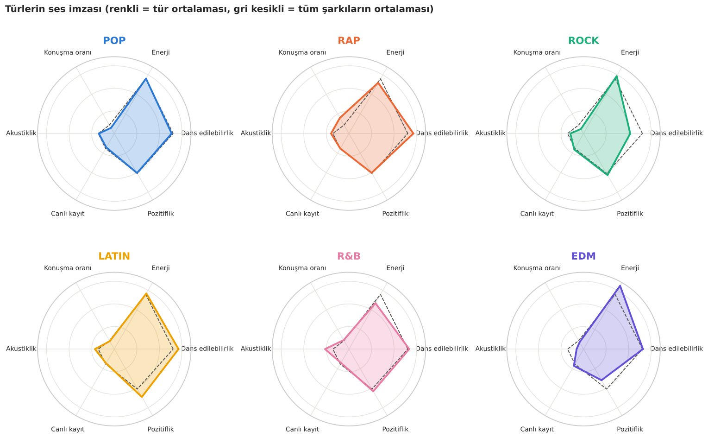
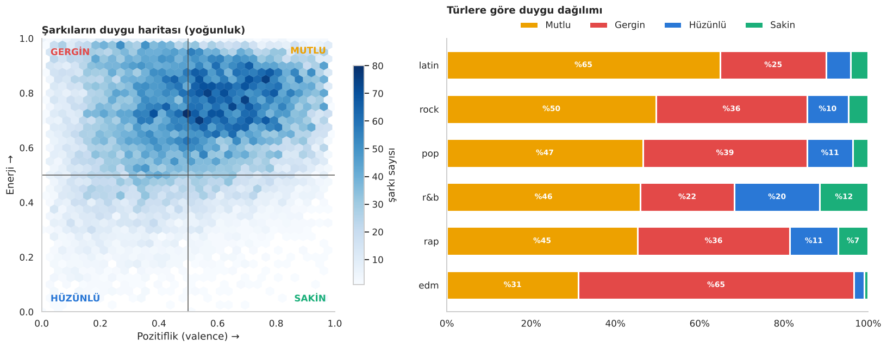
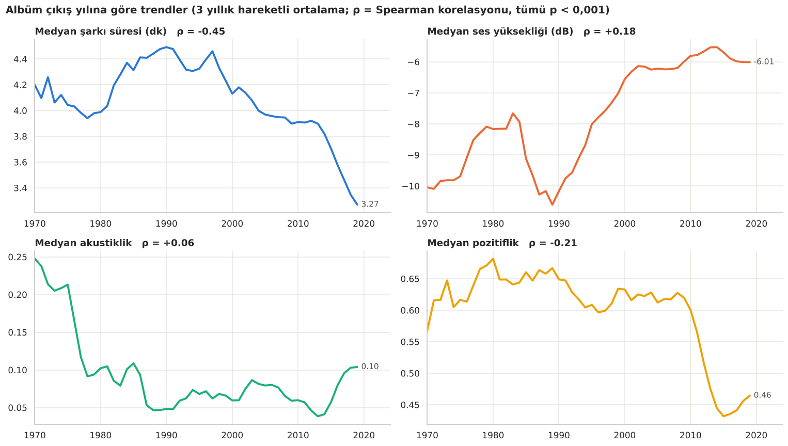
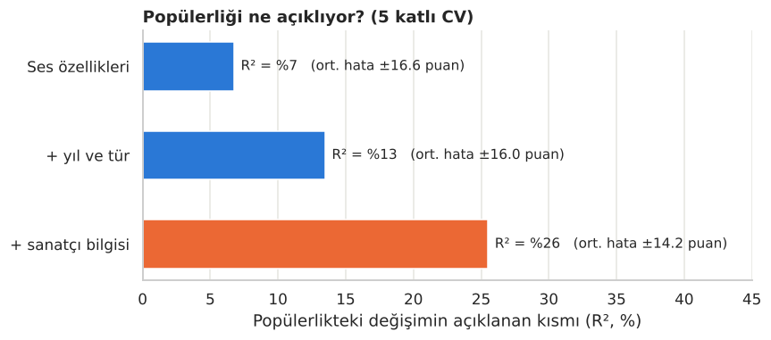
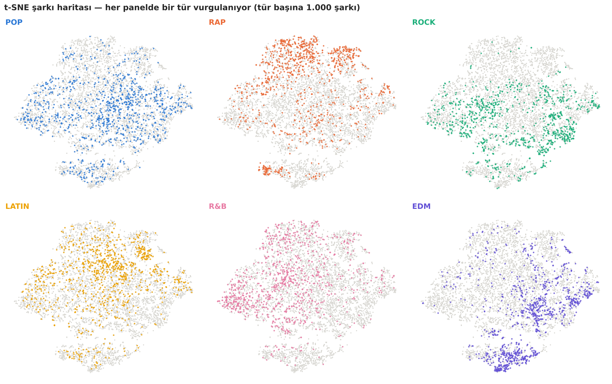
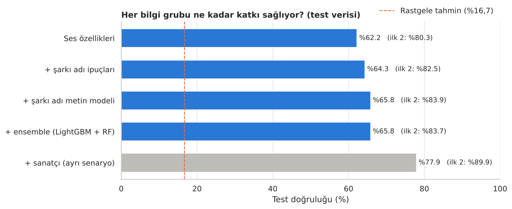
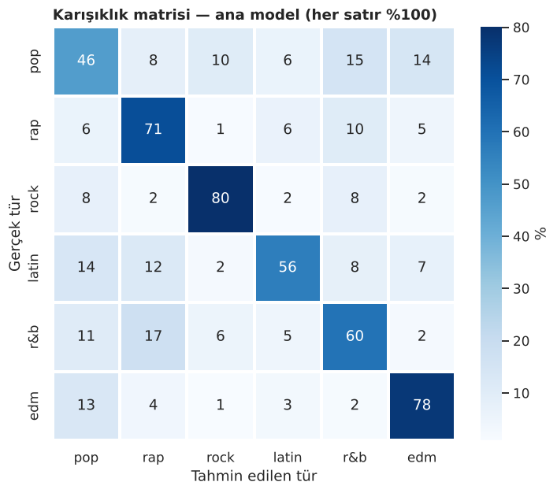
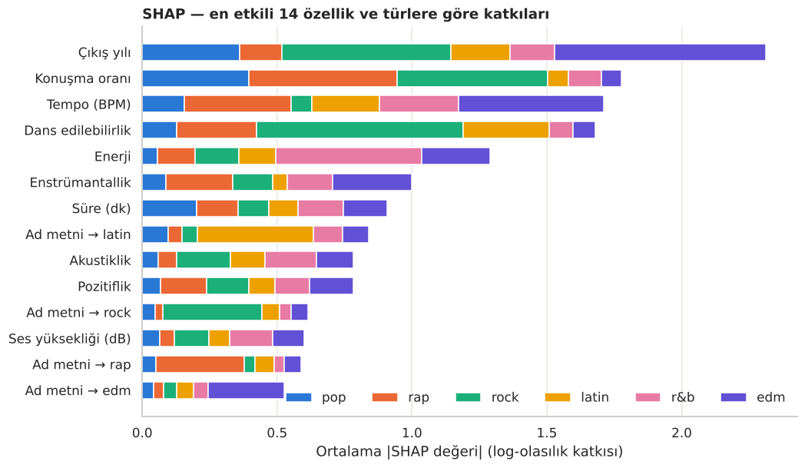
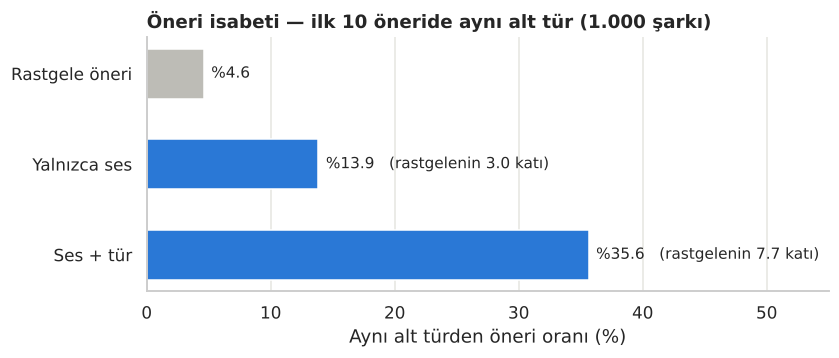

# 🎧 Spotify Şarkı Analizi: Türler, Duygular ve Makine Öğrenmesi

<p align="center">
  
  
  
  
  
</p>

<p align="center">
  <a href="https://nbviewer.org/github/Memreu/spotify-analizi/blob/main/spotify_analizi.ipynb"></a>
  <a href="https://colab.research.google.com/github/Memreu/spotify-analizi/blob/main/spotify_analizi.ipynb"></a>
</p>

~32 bin Spotify şarkısının ses özellikleriyle uçtan uca bir veri bilimi projesi: **keşifçi analiz**, **istatistiksel testler**, **boyut indirgeme**, **açıklanabilir makine öğrenmesi** ve **ölçülebilir bir öneri sistemi**.

Projenin ana sorusu: *Bir şarkının sesi, onun türü, duygusu ve başarısı hakkında ne söyler?*

<p align="center"></p>

> 🇬🇧 **In English:** An end-to-end data science project on ~32K Spotify tracks. It shows that music has become shorter, louder and sadder over time, that audio features explain only 7% of popularity (artist information matters far more), and builds a genre classifier (Optuna-tuned LightGBM + TF-IDF on track names, stacked) reaching **65.8% accuracy / 83.9% top-2** across 6 genres (random: 16.7%). The model is validated with an artist-grouped split, explained with SHAP, and paired with a content-based recommender that is **7.7× better than random** at finding songs from the same sub-genre.

<details>
<summary><b>📑 İçindekiler</b></summary>

- [Öne çıkan bulgular](#öne-çıkan-bulgular)
- [Görsel özet](#görsel-özet)
- [Tür tahmini modeli](#tür-tahmini-modeli)
- [Öneri sistemi](#öneri-sistemi)
- [Tüm sonuçlar](#tüm-sonuçlar)
- [Kullanılan yöntemler](#kullanılan-yöntemler)
- [Proje akışı](#proje-akışı)
- [Kurulum ve çalıştırma](#kurulum-ve-çalıştırma)
- [Veri](#veri)
- [Sınırlılıklar ve geliştirme fikirleri](#sınırlılıklar-ve-geliştirme-fikirleri)

</details>

## Öne çıkan bulgular

| | Bulgu |
|---|---|
| 😢 **Müzik hüzünleniyor** | 2010'larda hüzünlü + gergin şarkıların payı %32'den **%55'e** çıktı; şarkılar kısaldı (4,4 → 3,5 dk) ve yükseldi (−9,3 → −5,9 dB) |
| 🎤 **Başarıyı ses değil sanatçı belirliyor** | Ses özellikleri popülerliğin yalnızca **%7**'sini açıklıyor; sanatçı bilgisiyle **%26** |
| 🎯 **Tür tahmini** | Optuna ile ayarlı LightGBM + şarkı adından TF-IDF metin modeli (stacking): **%65,8 doğruluk**, **%83,9 ilk 2 doğruluk** (rastgele: %16,7) |
| 🧠 **Optimizasyon dersi** | Hiperparametre ayarı yalnızca ses özellikleriyle ~%62 tavanını aşamadı; kazanç modele **yeni bilgi** vermekten geldi |
| ✅ **Genelleme** | Sanatçıya göre bölmede (GroupKFold) doğruluk yalnızca **1,5 puan** düşüyor; model sanatçıları ezberlemiyor |
| 🎵 **Öneri sistemi** | Öneriler rastgeleye göre **7,7 kat** daha sık aynı alt türden geliyor |

## Görsel özet

**Duygu haritası:** Russell'ın duygu modeline göre (pozitiflik × enerji) şarkılar dört bölgeye ayrılıyor. Latin şarkıların %65'i "mutlu" bölgede; EDM ise yüksek enerjisine rağmen %65 oranında "gergin".

<p align="center"></p>

**Zaman içinde müzik:** 1990'lardan bu yana şarkılar kısalıyor, yükseliyor ve pozitiflikleri belirgin şekilde düşüyor. Tüm trendler Spearman testiyle anlamlı (p < 0,001).

<p align="center"></p>

**Popülerlik:** Bir şarkının ne kadar dinleneceğini sesi değil, büyük ölçüde onu kimin söylediği belirliyor.

<p align="center"></p>

<details>
<summary><b>🗺️ t-SNE şarkı haritası</b> (her panelde bir tür vurgulanıyor)</summary>
<p align="center"></p>
</details>

## Tür tahmini modeli

Model 6 ana türü (pop, rap, rock, latin, r&b, edm) tahmin ediyor. Her adımda modele ne kadar katkı geldiği ayrı ayrı ölçüldü:

<p align="center"></p>

| Adım | Test doğruluğu | İlk 2 doğruluk |
|---|---|---|
| Yalnızca ses özellikleri (Optuna ile ayarlı LightGBM) | %62,2 | %80,3 |
| + şarkı adı ipuçları | %64,3 | %82,5 |
| + şarkı adı metin modeli (TF-IDF, stacking) — **final** | **%65,8** | **%83,9** |
| + ensemble (LightGBM + RF) | %65,8 | %83,7 |
| Sanatçı bilgisiyle (ayrı senaryo) | %77,9 | %89,9 |

**Modelin en iyi ve en zor türleri:** Rock (%80) ve EDM (%78) çok iyi ayrılıyor; pop (%46) ise en zor tür, çünkü diğer tüm türlerle örtüşüyor. SHAP analizi, modelin istatistiksel testlerle tutarlı şekilde düşündüğünü gösteriyor: rap için en belirleyici özellik konuşma oranı, rock için düşük dans edilebilirlik.

<p align="center">
  
  
</p>

## Öneri sistemi

Ses özellikleri ve tür bilgisinden oluşan vektörler üzerinde kosinüs benzerliğiyle çalışan bir öneri sistemi. Başarısı ölçülebilir bir kriterle test edildi: *ilk 10 öneri, şarkıyla aynı alt türden mi?*

<p align="center"></p>

Notebook'ta ayrıca ruh haline göre (mutlu, sakin, hüzünlü, gergin) otomatik çalma listesi oluşturan bir bölüm var.

## Tüm sonuçlar

| # | Konu | Bulgu |
|---|---|---|
| 1 | Türlerin ses imzası | Türleri en iyi ayıran özellikler **konuşma oranı** (ε² = 0,20) ve **dans edilebilirlik** (ε² = 0,19); *canlı kayıt* neredeyse hiç fark yaratmıyor (ε² = 0,005). |
| 2 | Duygular | **Latin** şarkıların %65'i "mutlu" bölgede; **EDM** yüksek enerjisine rağmen %65 oranında "gergin". Hüzünlü şarkıların en yüksek payı **r&b**'de (%20). |
| 3 | Zaman | Şarkılar **kısalıyor** (1990'larda medyan 4,4 dk → 2010'larda 3,5 dk), **yükseliyor** (−9,3 → −5,9 dB) ve **hüzünleniyor**: 2010'larda pozitiflik 0,62'den 0,47'ye düştü. |
| 4 | Popülerlik | Ses özellikleri popülerliğin yalnızca **%7**'sini açıklıyor; yıl ve tür ile %13, **sanatçı bilgisiyle %26**. |
| 5 | Tür tahmini | Final model **%65,8 doğruluk, 0,653 macro F1, %83,9 ilk 2 doğruluk**. Sanatçı bilgisiyle ayrı senaryoda **%77,9**. |
| 6 | Optimizasyon dersi | Hiperparametre ayarı ses özellikleriyle tavanı aşamadı; kazanç **yeni bilgiden** geldi. Ensemble bu veride ek katkı sağlamadı. |
| 7 | Genelleme | Sanatçıya göre bölmede (GroupKFold) doğruluk yalnızca **1,5 puan** düşüyor. |
| 8 | Hata analizi | En emin hataların çoğu **etiket gürültüsü** (ör. The Cure "pop" etiketli). |
| 9 | Öneri sistemi | Yalnızca ses özellikleriyle rastgeleye göre **3 kat**, tür bilgisiyle **7,7 kat** daha isabetli. |

**Genel çıkarım:** Ses özellikleri bir şarkının *türünü* ve *duygusunu* makul ölçüde ele veriyor ama *başarısını* açıklamıyor. Model doğruluğunu artırmanın yolu daha karmaşık algoritmalar değil, **farklı türde bilgi** eklemek oldu.

## Kullanılan yöntemler

| Alan | Yöntemler |
|---|---|
| **İstatistik** | Kruskal–Wallis testi + etki büyüklüğü (ε²), Spearman trend testleri |
| **Keşifçi analiz** | Radar grafikleri, Russell duygu modeli, korelasyon analizi, t-SNE |
| **Makine öğrenmesi** | LightGBM, Optuna (TPE), TF-IDF + lojistik regresyon, stacking, soft-voting ensemble, katlama dışı hedef kodlama |
| **Doğrulama** | Stratified K-Fold, sanatçıya göre GroupKFold, ilk 2 doğruluk, macro F1 |
| **Açıklanabilirlik** | SHAP (tür bazında), karışıklık matrisi, alt tür hata analizi |
| **Öneri sistemi** | Kosinüs benzerliği, alt tür isabet oranı ile ölçüm |

## Proje akışı

| # | Bölüm |
|---|---|
| 1–2 | Kurulum, veri ve temizlik |
| 3 | Türlerin ses imzası (dağılımlar, radar grafikleri) |
| 4 | İstatistiksel testler: türler gerçekten farklı mı? |
| 5 | Duygu haritası |
| 6 | Zaman içinde müzik |
| 7 | t-SNE ile şarkı haritası |
| 8 | Popülerlik: ses mi, sanatçı mı? |
| 9 | Tür tahmini: metin modeli, Optuna, adım adım katkı, genelleme testi, SHAP, hata analizi |
| 10 | Öneri sistemi ve ruh haline göre çalma listesi |
| 11 | Sonuçlar |

## Kurulum ve çalıştırma

```bash
git clone https://github.com/Memreu/spotify-analizi.git
cd spotify-analizi
pip install -r requirements.txt
jupyter lab spotify_analizi.ipynb
```

**Run ▸ Run All Cells** ile çalıştır. Veri ilk çalıştırmada otomatik indirilir; tüm notebook ~12 dakika sürer.

**Kurulum yapmadan incelemek için:**
- 📓 [nbviewer'da görüntüle](https://nbviewer.org/github/Memreu/spotify-analizi/blob/main/spotify_analizi.ipynb): Tüm çıktı ve grafiklerle, hiçbir şey kurmadan okunabilir.
- ☁️ [Google Colab'da çalıştır](https://colab.research.google.com/github/Memreu/spotify-analizi/blob/main/spotify_analizi.ipynb): İlk hücreden önce şu komutu çalıştırman yeterli:
  ```python
  !pip install -q optuna shap
  ```

### Klasör yapısı

```
├── spotify_analizi.ipynb   # Ana notebook (çıktılarıyla birlikte)
├── images/                 # README grafikleri
├── requirements.txt
├── LICENSE
└── README.md
```

## Veri

[TidyTuesday: Spotify Songs (2020-01-21)](https://github.com/rfordatascience/tidytuesday/tree/master/data/2020/2020-01-21). Spotify API'den toplanmış ~32 bin şarkı; 6 ana tür ve 24 alt tür, her şarkı için dans edilebilirlik, enerji, pozitiflik, tempo gibi 12 ses özelliği.

## Sınırlılıklar ve geliştirme fikirleri

- **Etiketler çalma listelerinden geliyor.** Tür bilgisi şarkının değil, eklendiği çalma listesinin türü; bu da etiket gürültüsü yaratıyor ve doğruluğun üst sınırını belirliyor.
- **Ses özellikleri Spotify'ın özet metrikleri.** Ham ses sinyali (spektrogram) kullanılmadı.
- **Geliştirme fikirleri:**
  - Şarkı sözlerini ekleyip NLP ile hem tür tahminini hem duygu analizini güçlendirmek
  - 24 alt türü hiyerarşik bir modelle tahmin etmek (önce ana tür, sonra alt tür)
  - Öneri sistemini işbirlikçi filtreleme (kullanıcı dinleme verisi) ile birleştirmek

---

Bu proje [MIT lisansı](LICENSE) ile paylaşılmaktadır.

**Mehmet Emre Ünlü** · [GitHub](https://github.com/Memreu) · [LinkedIn](https://www.linkedin.com/in/memreu) · [Kaggle](https://www.kaggle.com/memreu)
